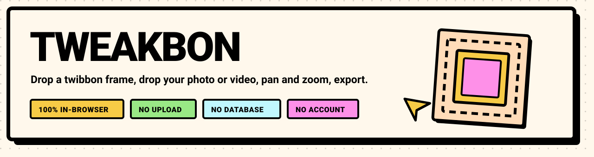
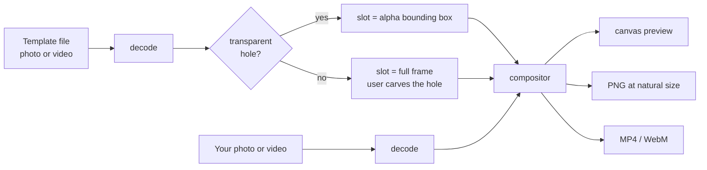

<div align="center">



# Tweakbon

**Put your photo or video inside any twibbon frame — in your browser.**

No upload. No account. No database.

[](LICENSE)
[](https://github.com/0xMinomus/tweakbon/actions/workflows/ci.yml)
[](src)
[](docs/privacy.md)

</div>

---

Tweakbon is a client-side Twibbon editor. You bring a frame template and a photo or video,
position it inside the frame, and export a PNG or an MP4. Everything — decoding,
compositing, chroma keying, background removal, encoding — happens inside your tab. Your
files are never uploaded, never stored, and never touch a server.

It is deliberately small: no accounts, no template marketplace, no social features, no
backend. Just the composite and the export.

## Why it exists

Most twibbon makers ask you to upload a photo to their server, then hand back a watermarked
result a few seconds later. That is a strange trade for a profile picture: you give away the
original file to get a derived one.

Tweakbon flips it. The template and your media stay in the tab, the compositor runs on the
canvas you can see, and the exporter writes the file directly to your downloads folder. The
whole app is a static bundle — it can be served from a CDN, a USB stick, or `file://`.

## Features

**Frames that actually fit the real world**

- Photo **or** video templates, either as your own upload.
- A template **with** a transparent hole works immediately: the hole is found by scanning
  the alpha channel and turned into the slot your media sits in.
- A template **without** any transparency — a JPEG scan, a plain MP4 — also works. The
  editor gives it a full-frame slot and lets you carve the hole out of the frame itself:
  chroma key for a video template, magic wand or brush for a photo template.
- Every carve is non-destructive: the original file is never modified, only the mask or the
  key settings you adjust.

**Editing**

- Drag to pan, wheel or pinch to zoom, one tap to rotate 90°, flip, reset.
- Arrow keys pan, `+`/`-` zoom, `R` rotates, `0` resets. Every gesture has a keyboard path.
- Transform is anchored to the slot, not the canvas, so changing the template does not throw
  away a careful position.
- Renders are coalesced into a single `requestAnimationFrame` pass, never one per event.

**Export**

- PNG still at the template's natural resolution, transparent where the frame is.
- MP4 (H.264) or WebM motion via `MediaRecorder`, capped at 30 seconds, using the clip window
  you picked for your video.
- Filenames are stable: `tweakbon-<template>.png` / `tweakbon-<template>.mp4`.

**Interface**

- Neo-brutalist visual language, heavy borders, hard shadows, one accent per action.
- A paper-plane cursor that tracks pointer movement 1:1 and banks toward the direction of
  travel.
- Indonesian copy (the audience), English code and documentation.

## Privacy by design

This is the part worth verifying rather than trusting.

| Claim | How it holds |
| --- | --- |
| Your photo or video is never uploaded | Files are read with the File API, decoded with `createImageBitmap` or an `<video>` element, and referenced through `URL.createObjectURL`. No `fetch`, no `XMLHttpRequest`, no `FormData`, no WebSocket anywhere in `src/`. |
| There is no database | There is no server, no API, no cloud storage, and no sync. The repository has no backend directory and no runtime secrets. |
| Nothing is persisted locally | Tweakbon does not write cookies, `localStorage`, `sessionStorage`, or IndexedDB. Close the tab and the session is gone. |
| No third-party calls | No analytics, no telemetry, no hosted fonts, no CDN scripts. React and Vite are bundled at build time. |
| You can check it in ten seconds | Open DevTools → **Network**, clear it, then drop in a photo and export. The list stays empty for every user file. |

The only network activity that ever existed in this app was fetching a template from your own
origin, and that path was removed — templates now always come from your file picker.

Read [`docs/privacy.md`](docs/privacy.md) for the long version, and
[`SECURITY.md`](SECURITY.md) for how to report a problem.

## How it works

Two inputs, one canvas, one order of layers.



### Layer order

The template is always the top layer. Its transparency is the composition mask: the media is
drawn behind it and shows through wherever the frame is transparent.

```
canvas
 ├─ your media, transformed into slot space, clipped to the slot
 └─ template on top — its alpha reveals the media
```

Nothing is punched out with `globalCompositeOperation` when the template already carries
alpha, and the media is never drawn over the frame.

### Coordinate spaces

| Space | Unit | Used by |
| --- | --- | --- |
| Slot space | normalised `0..1` of the slot rectangle | editor state, gestures, persisted adjustments |
| Template space | template natural pixels | renderer and exporter only |
| Display space | CSS pixels × `devicePixelRatio` | canvas element sizing only |

Editor state stores the transform **relative to the slot**, never to the template. A frame
whose hole moves does not invalidate a saved adjustment.

### Carving a hole

- **Chroma key (video template)** — a 32³ RGB lookup table classifies each pixel against the
  key colour, with separate controls for match width, edge softness, and de-spill. The key is
  applied to the template frames, not to your media.
- **Cutout mask (photo template)** — magic-wand flood fill, eraser and restore brushes, plus a
  one-click auto erase that samples the border ring. The mask is baked into the template with
  `destination-in` compositing at the template's native size.

More detail, including the render pipeline and the export encoder, is in
[`docs/architecture.md`](docs/architecture.md).

## Getting started

Requires **Node 22 LTS or newer** and npm.

```bash
git clone https://github.com/0xMinomus/tweakbon.git
cd tweakbon
npm install
npm run dev          # http://localhost:5173
```

Build a static bundle into `dist/`:

```bash
npm run build
npm run preview
```

There is no `.env` file to fill in, no API key to obtain, and no service to start.

## Scripts

| Script | What it does |
| --- | --- |
| `npm run dev` | Vite dev server with HMR |
| `npm run build` | `tsc --noEmit` then a production bundle |
| `npm run preview` | Serve the built bundle locally |
| `npm run typecheck` | Strict TypeScript check, no emit |
| `npm run lint` | ESLint flat config over the whole repo |
| `npm test` | Vitest single run |
| `npm run test:watch` | Vitest in watch mode |

All four gates — `typecheck`, `lint`, `test`, `build` — must pass before a change is merged.

## Using a template

Drop the frame into the left pane, drop your media into the right one, then open the editor.

| Template | What happens |
| --- | --- |
| PNG/WebP with a transparent hole | The hole becomes the slot; you pan and zoom your media inside it. |
| PNG/JPG/WEBP with no transparency | Full-frame slot. Open **Hapus latar template** and erase the area that should be transparent. |
| Video with alpha (WebM/VP9) | Slot sampled from an early frame, held for the clip. |
| Video with no alpha (MP4, WebM) | Full-frame slot. Chroma key is enabled from the corner colour of the first frame; adjust it in **Hapus latar template**. |

A manifest is built at runtime from the file you pick — there is no shipped catalog:

| Field | Meaning |
| --- | --- |
| `id`, `name` | Stable slug and display label |
| `kind` | `image` or `video` |
| `src` | Object URL of the decoded asset |
| `naturalWidth`, `naturalHeight` | Intrinsic pixel size |
| `slot` | Transparent region, normalised `0..1` |
| `slotPolygon` | Optional non-rectangular hole |
| `defaultFit` | Author hint for the initial fit |

## Project structure

```
src/
  app/            view switch, hero, editor, session hook
  features/
    template/     manifest schema, slot detection, manifest builder
    media/        decoding, object URL lifecycle
    editor/       transform reducer, chroma key, cutout operations
    render/       compositor, template keying, mask baking
    export/       PNG still, MediaRecorder motion
  components/     shared presentational UI
  styles/         design tokens, base styles, animations
  types/          shared contracts (template, media, transform)
tests/            integration checks
docs/             architecture, privacy
.github/          CI, issue and PR templates, README assets
```

Feature-first: a module belongs to the feature that owns the behaviour it implements.

## Browser support

Evergreen **Chromium, Firefox, and Safari**. The app requires `createImageBitmap` and
`OffscreenCanvas`; motion export additionally requires `MediaRecorder` and
`HTMLCanvasElement.captureStream`. No legacy support, no polyfills.

Known limits: motion export records in real time, so a slow machine records fewer frames;
video templates need a stationary hole because the slot is sampled once; the interface is not
yet localised beyond Indonesian.

## Accessibility

- The canvas has an accessible name and a live description of the current scale and offsets.
- Every pointer gesture has a keyboard equivalent, and the transform has an explicit reset.
- Focus rings are visible on every interactive element; dialogs and panels keep a labelled
  heading.
- `prefers-reduced-motion` disables the marquee, the cursor animation, and the reveal
  transitions.

## Contributing

Issues and pull requests are welcome. Start with [`CONTRIBUTING.md`](CONTRIBUTING.md) for the
workflow, code conventions, and the checklist a change has to clear. All participants are
expected to follow the [Code of Conduct](CODE_OF_CONDUCT.md).

## Security

The attack surface is file parsing in your own browser: the app has no server, no
credentials, and no outbound requests. If you find a problem — a decoder issue, a way to
exfiltrate data, a dependency advisory — please report it privately as described in
[`SECURITY.md`](SECURITY.md).

## License

[MIT](LICENSE) © Andika Putra.

The visual direction is inspired by neo-brutalist poster design. React, Vite, TypeScript and
Vitest do the heavy lifting; no other runtime dependencies are shipped.
