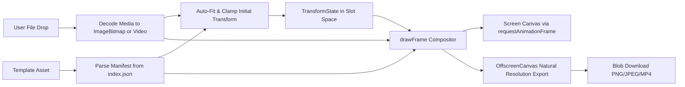

# Architecture & System Design

Tweakbon is structured around strict separation of domain logic, canvas rendering, and user interface state. Refer to [AGENTS.md](../AGENTS.md) for repository guidelines and development workflows.

## Three Architectural Layers

The system is organized into three distinct layers:

1. **Domain (Pure TypeScript)**
   - Located in `src/features/editor/`, `src/features/template/`, and `src/lib/`.
   - Handles geometry calculations, transform clamping, slot aspect ratios, and manifest parsing.
   - Contains zero DOM references, React imports, or Canvas rendering calls.
   - Completely deterministic and unit-testable in isolation.

2. **Rendering (Canvas 2D Engine)**
   - Located in `src/features/render/` and `src/features/export/`.
   - Translates domain state into pixels using HTML5 Canvas 2D and OffscreenCanvas APIs.
   - Enforces layer ordering, coordinate transformation, slot clipping, and device pixel ratio (DPR) scaling.
   - Decoupled from React lifecycle via explicit render calls and frame input structures.

3. **User Interface (React)**
   - Located in `src/app/` and `src/components/`.
   - Provides view routing, gesture event capture, file selection, and control surfaces.
   - Holds no internal geometry math; delegates all transformations to domain functions.
   - Keeps large, non-serializable objects (`ImageBitmap`, `HTMLVideoElement`) outside React state.

## Coordinate Spaces & Slot-Space Convention

Tweakbon operates across three distinct coordinate systems:

| Coordinate Space | Units | Usage |
|---|---|---|
| Slot space | Normalized `0..1` of slot bounds | Editor transform state, gesture offsets, persisted adjustments |
| Template space | Natural template pixels | Canvas compositor, clipping path setup, export rendering |
| Display space | CSS pixels multiplied by `devicePixelRatio` | Interactive screen canvas element sizing and pointer event mapping |

### Why Slot Space Matters

The user transform (`offsetX`, `offsetY`, `scale`, `rotation`, `flipX`) is stored strictly relative to the template's slot, rather than relative to the entire template canvas:
- `scale = 1` means the media covers the slot boundaries completely.
- `offsetX = 0` and `offsetY = 0` center the media within the slot rectangle.
- If a template designer updates the artwork and relocates or resizes the transparent slot, existing user adjustments remain valid because the media moves with the slot.

## Layer Ordering & Top-Layer Composition

In Tweakbon, the template is always the top layer:

```
Canvas Output
 ├─ Layer 1 (Bottom): User media, transformed into slot space and clipped to slot bounds
 └─ Layer 2 (Top): Template graphic, covering the canvas; its transparent cutout reveals the media
```

### Rationale

The transparent hole in the template asset acts as the natural compositing mask.
- Never punch holes using canvas `globalCompositeOperation = 'destination-out'` when the template graphic already contains an alpha channel.
- Never draw user media on top of the template frame, which would obscure borders, overlays, and decorative elements.

### Draw Order Inside `drawFrame`

Every rendering pass executes in this exact sequence:

1. `ctx.clearRect(0, 0, outputWidth, outputHeight)`: Clears the entire destination buffer.
2. `ctx.save()`: Preserves initial canvas context state.
3. Clip to slot: Creates a clipping path matching `manifest.slot` (or `manifest.slotPolygon` when defined) scaled to destination pixels.
4. Transform media: Translates to the slot center, applies user offset, rotation, scale, and horizontal flip.
5. Draw media: Renders the media source centered at the transformed origin.
6. `ctx.restore()`: Restores context state, clearing the slot clipping path.
7. Draw template: Draws the template image stretched across the full output rectangle `(0, 0, outputWidth, outputHeight)`.

## Data Flow

From user file drop to downloadable composite blob:



1. **Input**: User drops an image or video, or selects one from disk.
2. **Decode**: Images decode via `createImageBitmap` respecting EXIF orientation; videos load into a looping, muted `<video>` element.
3. **Template Load**: Template SVG loads into an `ImageBitmap`, and its manifest is parsed and validated.
4. **Auto-fit**: Initial scale and position are computed to cover the slot while centering media.
5. **Interactive Adjustment**: Pointer drag, scroll wheel, pinch, and keyboard events trigger pure transform reducers, clamped against the rotated bounding box so the slot never reveals empty space.
6. **Compositing**: Redraws run on `requestAnimationFrame`, coalescing rapid gesture inputs into single rendering passes.
7. **Export**: The composite is rendered at template natural resolution onto an offscreen canvas and encoded into a downloadable Blob.

## Responsibility Map

| Directory | Primary Ownership | Key Responsibilities |
|---|---|---|
| `src/types/` | Shared Contracts | Immutable TypeScript interfaces: `TransformState`, `MediaSource`, `TemplateManifest`, `SlotRect`. |
| `src/lib/` | Shared Utilities | Pure geometry calculations, math helpers, and bounding box solvers. |
| `src/features/editor/` | Domain | Transform factory, reducer functions, scale and offset clamping within slot bounds. |
| `src/features/template/` | Domain | Manifest parsing, schema guards, catalog loading, and alpha mask slot detection. |
| `src/features/media/` | Media Engine | Media source loading, format detection, resource cleanup, and object URL lifecycle. |
| `src/features/render/` | Rendering | Canvas 2D layer compositor (`drawFrame`), clipping paths, and DPR handling. |
| `src/features/export/` | Export Engine | Natural resolution offscreen rendering, still image encoding, and video stream recording. |
| `src/components/` | Presentational UI | Interactive canvas stage, drop zone, template picker, control panel, and neo-brutalist buttons. |
| `src/app/` | Application Shell | Top-level view switching, session hook orchestration, and cleanup on unmount. |
| `scripts/` | Tooling & QA | Independent Node ESM template validator for manifest geometry and asset files. |
| `tests/` | Verification | Automated test suites verifying catalog integrity and domain logic. |
