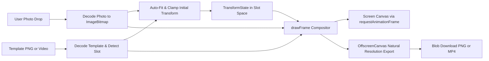

# Architecture & System Design

Tweakbon is structured around strict separation of domain logic, canvas rendering, and user interface state. Refer to [AGENTS.md](../AGENTS.md) for repository guidelines and development workflows.

## Three Architectural Layers

The system is organized into three distinct layers:

1. **Domain (Pure TypeScript)**
   - Located in `src/features/editor/` and `src/features/template/`.
   - Handles geometry calculations, transform clamping, slot aspect ratios, manifest construction, and alpha detection.
   - Contains zero DOM references, React imports, or Canvas rendering calls.
   - Completely deterministic and unit-testable in isolation.

2. **Rendering (Canvas 2D Engine)**
   - Located in `src/features/render/` and `src/features/export/`.
   - Translates domain state into pixels using HTML5 Canvas 2D and OffscreenCanvas APIs.
   - Enforces layer ordering: user media on bottom, template graphic or video on top.
   - Decoupled from React lifecycle via explicit render calls and frame input structures.

3. **User Interface (React)**
   - Located in `src/app/` and `src/components/`.
   - Provides two-pane upload hero (template on left, user photo on right), view routing, gestures, and control surfaces.
   - Includes header template changer for switching templates without leaving the editor.
   - Holds no internal geometry math; delegates all transformations to domain functions.
   - Keeps large, non-serializable objects (`PhotoMedia`, `TemplateSource`) outside React state.

## Coordinate Spaces & Slot-Space Convention

Tweakbon operates across three distinct coordinate systems:

| Coordinate Space | Units | Usage |
|---|---|---|
| Slot space | Normalized `0..1` of slot bounds | Editor transform state, gesture offsets, persisted adjustments |
| Template space | Natural template pixels | Canvas compositor, clipping path setup, export rendering |
| Display space | CSS pixels multiplied by `devicePixelRatio` | Interactive screen canvas element sizing and pointer event mapping |

### Why Slot Space Matters

The user transform (`offsetX`, `offsetY`, `scale`, `rotation`, `flipX`) is stored strictly relative to the template's slot, rather than relative to the entire template canvas:
- `scale = 1` means the photo covers the slot boundaries completely.
- `offsetX = 0` and `offsetY = 0` center the photo within the slot rectangle.
- If a template changes or resizes its transparent slot, existing photo adjustments remain valid because the photo moves relative to the slot.

### Zoom and Uncovered Media

The editor allows zooming out below initial cover scale down to `MIN_SCALE = 0.5`:

- **Scale Below 1**: When `scale < 1`, the photo bounding box shrinks smaller than the slot rectangle (`bboxW < 1 || bboxH < 1`). In this state, `isUncovered(transform, draw)` evaluates to `true`, and clamping locks that axis to offset 0 so the photo stays centered.
- **Background Fill**: Whenever photo media is uncovered, the compositor fills the slot area with `#FFF8EC` (the `--paper` design token) before rendering the transformed photo.
- **Opaque Export Invariant**: The slot must never export transparency. Without the `#FFF8EC` underlay, zoomed-out compositions would export PNGs with empty holes around the photo, or display unstyled black voids in JPEG formats and screen canvases.

## Layer Ordering & Top-Layer Composition

In Tweakbon, the template is always the top layer:

```
Canvas Output
 ├─ Layer 1 (Bottom): User media (photo or video), transformed into slot space and clipped to slot bounds
 └─ Layer 2 (Top): Template graphic or video, covering the canvas; its transparent cutout reveals the media
```

### Rationale

The transparent hole in the template asset acts as the natural compositing mask. If a template arrives without an alpha hole, the hole is created directly on the template: via background removal (cutout mask) for photo templates or chroma keying for video templates. User media is drawn plainly behind the template.
- Never punch holes using canvas `globalCompositeOperation = 'destination-out'` when the template graphic already contains an alpha channel.
- Never draw user media on top of the template frame, which would obscure borders, overlays, and decorative elements.

### Draw Order Inside `drawFrame`

Every rendering pass executes in this exact sequence:

1. `ctx.clearRect(0, 0, outputWidth, outputHeight)`: Clears the entire destination buffer.
2. `ctx.save()`: Preserves initial canvas context state.
3. Clip to slot: Creates a clipping path matching `manifest.slot` (or `manifest.slotPolygon` when defined) scaled to destination pixels.
4. Background underlay: If `isUncovered(transform, draw)` is true, fills the clipping path with `#FFF8EC`.
5. Transform photo: Translates to the slot center, applies user offset, rotation, scale, and horizontal flip.
6. Draw photo: Renders the photo source centered at the transformed origin.
7. `ctx.restore()`: Restores context state, clearing the slot clipping path.
8. Draw template: Draws the template image or video frame stretched across the full output rectangle `(0, 0, outputWidth, outputHeight)`. For video templates with `readyState < 2`, the template draw is skipped while the photo remains visible.

## Data Flow

From upload to downloadable composite blob:



1. **Input**: User supplies a template (PNG with transparency or video file) on the left pane and a personal photo on the right pane.
2. **Decode**: Photo decodes via `createImageBitmap` respecting EXIF orientation. Image templates decode to `ImageBitmap`; video templates mount to a muted looping `<video>`.
3. **Template Slot Detection**: The slot is detected from alpha channel data. For video templates, frame 0 is decoded and analyzed once at load time, and the resulting slot coordinates are held constant for the entire clip.
4. **Video Template Mask Constraint**: Because the slot is sampled once at frame 0, the transparent region in a video template must remain stationary relative to the frame. If the hole moves in the video, the cutout mask drifts away from the stationary photo underneath.
5. **Video Template Codec**: The template no longer has to carry per-pixel alpha. WebM/VP9 with alpha is supported directly, and opaque MP4/WebM videos are now valid: they load with a full-frame slot and are keyed at runtime via chroma key to carve the slot.
6. **Auto-fit**: Initial scale and position are computed to cover the slot while centering the photo.
7. **Interactive Adjustment**: Pointer drag, scroll wheel, pinch, and keyboard events trigger pure transform reducers, clamped against the rotated bounding box.
8. **Compositing**: Redraws run on `requestAnimationFrame`, filling `#FFF8EC` under uncovered photo regions and drawing the template frame on top.
9. **Export**: The composite renders at natural resolution onto an offscreen canvas and encodes into a downloadable PNG (for still templates) or MP4 (for video templates).

## In-Editor Template and Photo Controls

The editor provides distinct controls for template and photo management:

- **Header Template Switcher**: The editor header includes a dedicated template replacement button. Users can pick a new PNG or video template directly without returning to the landing view or losing current session context.
- **Control Panel Photo Replacement**: Photo replacement remains available within the editor control panel, alongside zoom, rotation, horizontal flip, and reset adjustments. The former generic media switcher in the header has been replaced by the template changer.

## Video Template & Chroma Key

When a video template is opaque or requires background removal, chroma keying is applied to the **template** via `drawKeyedVideoFrame` to carve the slot:

- **Processing Flow**: Video templates are decoded into a looping `<video>` element. When chroma key is enabled, `drawKeyedVideoFrame` processes template frames onto an intermediate work canvas capped at 1280 px (or display cap) before compositing on top of the user media.
- **LUT Acceleration**: Keying uses a precomputed 32³ (32,768 entries) RGB lookup table built by `buildChromaKeyLut`.
- **Despill Filter**: `despill` removes key colour contamination specifically on edge pixels between similarity and smoothness thresholds.
- **Settings Contract**: `ChromaKeySettings` (`similarity`, `smoothness`, `spill`) normalize all controls to the `0..1` range for UI slider binding.
- **Playback Window & Export**: For user video media, `VideoTrim` (`start`, `end`) sets the preview and export playback window. Total motion export duration is constrained by `min(trimDuration, templateDuration, 30s)`.

## Photo Template Cutout Mask

Photo templates support background removal and fine adjustment via an in-memory cutout mask to carve the transparent slot:

- **Mask Format**: `CutoutMask` stores an alpha buffer (`Uint8ClampedArray`) row-major in template pixel coordinates (`0` = removed, `255` = kept).
- **Immutability**: Every mask edit produces a new mask object to keep state transitions explicit.
- **Domain Operations**:
  - `magicWandErase`: 4-neighbour flood fill erasing contiguous matching regions from a seed coordinate within color tolerance.
  - `autoEraseBackground`: global eraser sampling the outer boundary ring average and clearing all pixels within tolerance across the entire image.
  - `strokeMask`: circular brush stamping along line segments for manual erasing (`keep = false`) or restoring (`keep = true`).
- **Compositor Integration & Export**: The mask is capped to a 2048 px working resolution for edits and smoothly resampled back to full template size at bake time, and `bakeMaskedTemplate` applies it with destination-in compositing to the template frame. The resulting alpha mask renders cleanly in both interactive canvas stages and full-resolution PNG exports.

## Cursor Lifecycle, Angle Unwrapping & Opt-Outs

The interface features an interactive paper-plane cursor (`.cursor-plane`):

- **1:1 Movement Tracking**: The plane follows pointer translation immediately without positional lag.
- **Angle Unwrapping**: To eliminate 360-degree rotational discontinuities when passing through `atan2` branch cuts, target angles are unwrapped relative to the current rendered angle using `delta = ((target - current + 540) % 360) - 180`.
- **Rotational Interpolation**: The cursor rotates toward its target angle via linear interpolation once per `requestAnimationFrame`, ensuring seamless multi-revolution spins without snapping or broken frames.
- **Loop Halting**: The animation loop halts when pointer movement settles and the rotational delta falls below 0.1 degree, preserving CPU cycles during idle periods.
- **Idle Float**: When the pointer rests, the cursor transitions into a gentle float rather than disappearing.
- **Global `cursor: none`**: Native cursors are hidden globally across the viewport while the paper plane is active.
- **Never Falls Back**: Once the plane is active, `cursor-plane-active` stays on `<html>` until unmount — `pointerleave` and `blur` only hide the plane graphic. The hide rule also covers pseudo-elements (`::-webkit-slider-thumb`, `::-moz-range-thumb`, track and scrollbar), so dragging the zoom slider cannot surface the native cursor.
- **Canvas Stage & Drag Feedback**: The canvas stage no longer displays native `cursor: grab` or `cursor: grabbing`. Instead, the `.cursor-plane-grabbing` class is applied to the paper plane element for tactile drag feedback.

### Cursor Opt-Outs

The custom cursor automatically disables under two conditions:

1. **Reduced Motion**: Under `prefers-reduced-motion: reduce`, the custom cursor element is hidden and native cursor behavior remains active.
2. **Touch & Mobile Pointers**: Devices matching `(hover: none)` or coarse pointer queries omit the plane cursor entirely.
## Responsibility Map

| Directory | Primary Ownership | Key Responsibilities |
|---|---|---|
| `src/types/` | Shared Contracts | Immutable TypeScript interfaces: `TransformState`, `PhotoMedia`, `TemplateSource`, `TemplateManifest`, `SlotRect`. |
| `src/features/editor/` | Domain | Transform factory, reducer functions, scale and offset clamping within slot bounds, `isUncovered` check. |
| `src/features/template/` | Domain | Manifest parsing, `buildTemplateManifest`, schema guards, and alpha mask slot detection. |
| `src/features/media/` | Media Engine | Photo and video loading (`loadPhotoFile`, `loadVideoFile`), custom template loading (`loadCustomTemplateFile`), resource cleanup, and object URL lifecycle. |
| `src/features/render/` | Rendering | Canvas 2D layer compositor (`drawFrame`), uncovered slot background fills, clipping paths, and DPR handling. |
| `src/features/export/` | Export Engine | Natural resolution offscreen rendering, still PNG encoding, and video stream recording. |
| `src/components/` | Presentational UI | Interactive canvas stage, two-pane hero components, control panel, and paper-plane cursor. |
| `src/app/` | Application Shell | Top-level view switching, session hook orchestration, and cleanup on unmount. |
| `tests/` | Verification | Automated test suites verifying custom template detection and domain logic. |
